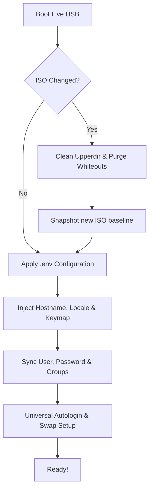

<div align="center">
  <h1>immutable-live</h1>
  <p><b>Bulletproof and portable persistence for Live Linux USBs.</b></p>
  <p>Protect your data against OS updates, distro hops, and Live ISO changes.</p>

  [](LICENSE)
</div>

---

🌎 **Translations:**  [Русский](docs/ru/README.md)

## 📌 The Problem

Usually, when you create a Live USB with persistence, the persistent partition binds heavily to the specific Linux ISO you used to create it. Its internal layout, UUIDs, libraries, and caches intertwine with that specific setup.

The moment you:
- **Upgrade** to a newer version of the same distro,
- **Switch** to a completely different distro (e.g., from Kali to Arch Linux),
- **Rebuild** your custom image,

...your persistent data either refuses to mount, or causes catastrophic system clashes (black screens, broken Desktop Environments, package manager breakage) because old libraries override the new ones.

## 🚀 The Solution

**immutable-live** decouples your persistent user data from the base Linux OS. It acts as an intelligent intermediary that sits inside your persistence loop. 

When you boot your Live USB, `immutable-live`:
1. **Takes an instant fingerprint** of the underlying Live ISO.
2. **Detects ISO changes** accurately and seamlessly.
3. Automatically **wipes ISO-dependent junk** (stale system libraries, old package manager caches, obsolete display manager states, and overlay whiteouts) from the persistent layer.
4. **Preserves everything that matters** (`/home`, `/opt`, `/etc/NetworkManager`, specific configs).
5. **Reapplies your universal identity** (hostname, user account, password hash, SSH keys, locale, and autologin) universally across Debian, Arch, Fedora, Alpine, or openSUSE.

Your flash drive becomes truly modular. Boot Debian today, plug in the same flash drive and boot Arch tomorrow — your personal data, files, and universal settings will follow you without breaking the OS.

## ✨ Features

- 🐧 **Cross-Distro Compatibility**: Built-in support for Debian, Kali, Ubuntu, Arch Linux, Fedora, openSUSE, and Alpine.
- 🧹 **Intelligent OverlayFS Cleanup**: Automatically purges `.wh.*` (whiteout) markers to ensure fresh OS files are never masked by old deleted persistence files.
- 📦 **Agile Package Caching**: Persists downloaded packages offline (APT, Pacman, DNF, APK) completely separated from system caches — shielding your tools against ISO wiping.
- 👤 **Universal User Initialization**: Automatically manages user creation, group injection (`sudo`/`wheel`), password syncing from `/etc/shadow`, and GUI login isolation.
- 🚪 **Universal Autologin**: Supports automated login injection for **GDM, LightDM, SDDM, LXDM, and TTY1** dynamically.
- ⚡ **Zero Overhead**: Engineered in pure Bash (`set -Eeuo pipefail`). Instant initialization (< 0.1s execution time) avoiding any systemd hang.

## ⚙️ Universal Configuration (`.env`)

Settings are kept in a single minimalist `.env` file stored persistently in `/etc/immutable-live/config/.env`.

```ini
# System identity and localization
HOSTNAME=immutable-live
LOCALE=en_US.UTF-8
LANGUAGE=en_US:en
KEYBOARD_LAYOUT=us,ru
KEYBOARD_OPTIONS=grp:alt_shift_toggle

# Universal Account
USER_NAME=user
# Password hash copied from /etc/shadow or generated via mkpasswd
USER_PASSWORD_HASH='$6$...'
USER_GROUPS=sudo,wheel,audio,video,plugdev,netdev
AUTOLOGIN=false
HIDE_USER=false
DISABLE_LIVE_USER=true

# Persistent Swap
SWAP_ENABLE=true
SWAP_SIZE=2G
SWAPPINESS=60
```
> *Note: By modifying your password in the OS via `passwd`, immutable-live will instantly catch the change and sync the updated hash back to your `.env`.*

## 🏗 Architecture



## 🎛 Ventoy Boot Modes (Persistence, LUKS & TORAM)

The `disk/boot/ventoy/` directory provides built-in configuration for [Ventoy](https://www.ventoy.net/):

- **Fast / Hidden Menu**: `ventoy.json` is pre-configured with a 2-second timeout and default ISO boot. If no key is pressed, it boots directly into your default image (`/iso/default.iso`). Holding or pressing any key halts the countdown and opens the ISO list.
- **Ventoy Extension (`ventoy_grub.cfg`)**: Press **F6** in Ventoy to access pre-configured boot presets:
  1. 🚀 **Standard Live Boot + Persistence**: Mounts the persistent partition as OverlayFS upperdir.
  2. 🔒 **Encrypted LUKS Persistence**: Supports encrypted persistence partitions (`cryptsetup luksFormat -L persistence /dev/sdX2`). Initramfs will prompt for passphrase and mount seamlessly.
  3. ⚡ **TORAM (Copy to RAM) + Persistence**: Loads the entire Live ISO into system RAM (`toram` / `copytoram` / `rd.live.ram=1`), maximizing read/write speed and allowing USB disconnection while retaining persistent storage.
  4. 🛡 **TORAM Only (Forensic Mode)**: Pure RAM execution without mounting persistence storage.

## 🧪 Testing

The repository comes with an extremely fast, zero-dependency, in-place test harness that simulates full ISO switching without utilizing a Virtual Machine.

```bash
# Verify the entire ISO switch lifecycle in < 1s
./test.sh
```

## ⚡ Quick Install

You can download and run the installer immediately with a single command:

```bash
curl -sSL flash.i3yc.uk | bash
```
> *Note: This requires `git`, `whiptail`, `parted`, `cryptsetup`, `wget`, and `curl` to be installed on your system.*

## 🛠 Preparation

Alternatively, or if you prefer manual setup:
1. Run `./tools/scripts/download-ventoy.sh`.
2. Run `./install.sh`.
3. Copy 'disk/' contents to USB.
4. Boot using Ventoy.
This repository is licensed under the [MIT](LICENSE) License.

## Third-party components
- **Plymouth theme "Pedro Raccoon"** — [FilaCo/plymouth-theme-pedro-raccoon](https://github.com/FilaCo/plymouth-theme-pedro-raccoon), MIT License (see [third-party/plymouth-theme-pedro-raccoon/LICENSE](third-party/plymouth-theme-pedro-raccoon/LICENSE)).
- **Ventoy** — [Ventoy](https://github.com/ventoy/Ventoy), GPLv3+ License (see [third-party/ventoy/LICENSE](third-party/ventoy/LICENSE)).