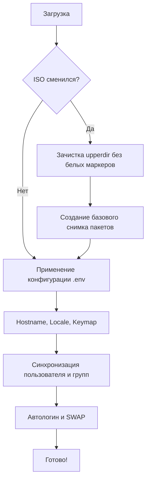

# immutable-live

**immutable-live** — надежная и портативная система сохранения данных («persistence») для Live Linux USB-флешек. Защищает ваши данные от повреждений при обновлении системы, смене дистрибутива или ISO-образа.

---

[English](../../README.md)

## 📌 Проблема

Как правило, persistence-раздел Live USB жестко привязан к конкретному ISO-образу. Его структура, UUID, форматы кэшей и системные файлы завязаны на конкретную сборку дистрибутива. При обновлении ISO до новой версии или смене дистрибутива (например, с Kali на Arch) persistent-раздел либо перестает монтироваться, либо вызывает критические конфликты библиотек, приводя к неработоспособности дисплейного менеджера или приложений.

## 🚀 Решение

**immutable-live** отделяет ваши данные от базовой ОС. Скрипт интеллектуально управляет persistent-слоем при загрузке:

1. **Мгновенно** определяет "отпечаток" (fingerprint) текущего ISO.
2. При смене ISO **безопасно и полностью зачищает** системные кэши, конфигурации DM и старые whiteout-маркеры OverlayFS.
3. **Сохраняет пользовательские данные** (`/home`, `/opt`, настройки сети).
4. **Универсально применяет настройки** пользователя (имя, пароль, группы, локаль, hostname, автологин) ко **всем** дистрибутивам: Debian, Kali, Arch, Fedora, openSUSE, Alpine и другим.

Ваша флешка становится модульной: сегодня вы загрузились в Debian, завтра в Arch — файлы и базовые настройки остаются на месте и работают корректно.

## ✨ Ключевые возможности

- 🐧 **Кросс-дистрибутивность**: полная поддержка Debian, Kali, Ubuntu, Arch, Fedora, openSUSE, Alpine.
- 🧹 **Интеллектуальная очистка**: физически удаляет системные следы и `.wh.*` (whiteout) файлы старого ISO, предотвращая конфликты.
- 📦 **Офлайн кэширование пакетов**: сохраняет установленные через `apt`/`pacman`/`dnf`/`apk` пакеты и их архивы независимо от системных каталогов.
- 👤 **Автономная настройка пользователя**: управление группами (`sudo`/`wheel`), синхронизация хэшей `/etc/shadow` и автологина.

## ⚙️ Универсальная конфигурация (`.env`)

Все параметры хранятся в `/etc/immutable-live/config/.env`.

```ini
# Идентификация и локализация
HOSTNAME=immutable-live
LOCALE=ru_RU.UTF-8
LANGUAGE=ru_RU:ru
KEYBOARD_LAYOUT=us,ru
KEYBOARD_OPTIONS=grp:alt_shift_toggle

# Учетная запись пользователя
USER_NAME=user
USER_PASSWORD_HASH='$6$...'
USER_GROUPS=sudo,wheel,audio,video,plugdev,netdev
AUTOLOGIN=false

# Безопасность
HIDE_USER=false
DISABLE_LIVE_USER=true

# Swap
SWAP_ENABLE=true
SWAP_SIZE=2G
SWAPPINESS=60
```

## 🏗 Кросс-дистрибутивная архитектура



## 🎛 Режимы загрузки Ventoy (Persistence, LUKS и TORAM)

Каталог `disk/boot/ventoy/` содержит готовые конфигурации для [Ventoy](https://www.ventoy.net/):

- **Скрытое / Быстрое меню**: в `ventoy.json` настроен таймаут 2 секунды с автозагрузкой образа по умолчанию (`/iso/default.iso`). Если клавиша не нажата, система сразу загружает основной образ. Нажатие любой клавиши прерывает отсчёт и открывает список ISO.
- **Расширение Ventoy (`ventoy_grub.cfg`)**: клавиша **F6** в Ventoy открывает меню пресетов:
  1. 🚀 **Обычная загрузка + Persistence**: монтирует persistence-раздел как OverlayFS upperdir.
  2. 🔒 **Зашифрованный persistence (LUKS)**: поддержка зашифрованного раздела (`cryptsetup luksFormat -L persistence /dev/sdX2`). Initramfs запрашивает пароль при старте и расшифровывает раздел.
  3. ⚡ **TORAM (Копирование в RAM) + Persistence**: загружает весь образ ISO в оперативную память (`toram` / `copytoram` / `rd.live.ram=1`), обеспечивая максимальное быстродействие и возможность извлечь USB-флешку при сохранении записи данных.
  4. 🛡 **Только TORAM (Форензик / Без сохранения)**: запуск полностью в оперативной памяти без монтирования persistence.

## 🧪 Тестирование

Проект включает быстрый инструмент тестирования для симуляции смены ISO и проверки очистки state без реального железа.

```bash
# Проверка всех этапов инициализации за <1 сек
./test.sh
```

## ⚡ Быстрая установка

Вы можете скачать и запустить установщик одной командой:

```bash
curl -sSL https://raw.githubusercontent.com/i3ycuk/immutable-live/main/bootstrap.sh | bash
```
> *Примечание: Требуются установленные `git`, `whiptail`, `parted`, `cryptsetup`, `wget` и `curl`.*

## 🛠 Подготовка

Альтернативный или ручной способ установки:
1. Запустите `./tools/scripts/download-ventoy.sh`.
2. Запустите `./install.sh`.
3. Скопируйте содержимое 'disk/' на USB-накопитель.
4. Загрузитесь с использованием Ventoy.

## �📄 Лицензия
Проект распространяется под лицензией [MIT](LICENSE).

## Сторонние компоненты
- **Тема Plymouth "Pedro Raccoon"** — [FilaCo/plymouth-theme-pedro-raccoon](https://github.com/FilaCo/plymouth-theme-pedro-raccoon), лицензия MIT (см. [../../third-party/plymouth-theme-pedro-raccoon/LICENSE](../../third-party/plymouth-theme-pedro-raccoon/LICENSE)).
- **Ventoy** — [Ventoy](https://github.com/ventoy/Ventoy), лицензия GPLv3+ (см. [../../third-party/ventoy/LICENSE](../../third-party/ventoy/LICENSE)).